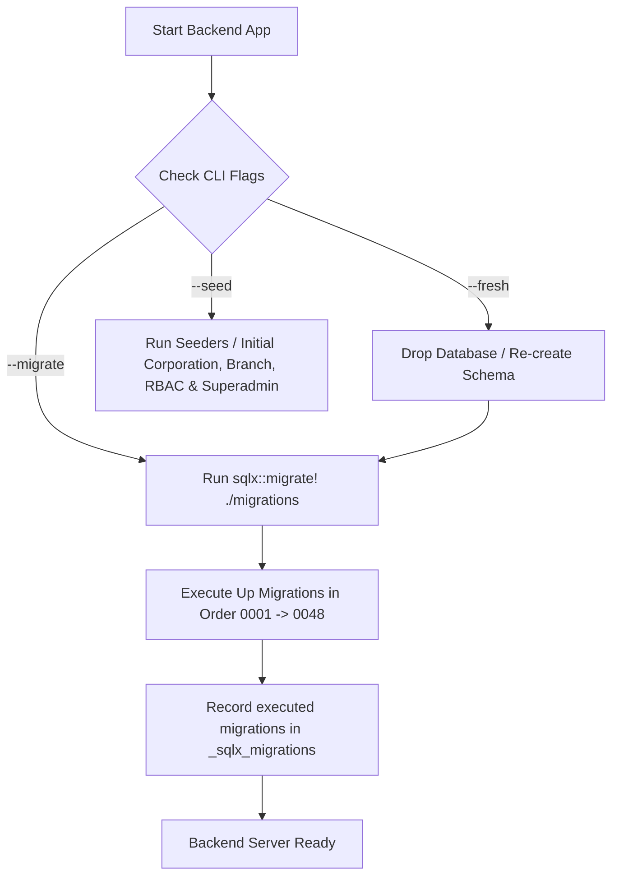

# DDL & Alur Migrasi Database HND Sigma Digital Signage Enterprise

Dokumen ini memetakan seluruh struktur **Data Definition Language (DDL)**, arsitektur modul **Multi-Tenancy (Corporations & Branches)**, **Authentication & IAM (Identity and Access Management)**, relasi antartabel, serta **alur migrasi database** di backend Rust.

---

## 1. Alur & Mekanisme Migrasi Database

Backend menggunakan **SQLx (`sqlx::migrate!`)** untuk manajemen migrasi PostgreSQL secara terotomatisasi, reversibel (setiap `.up.sql` memiliki pasangan `.down.sql`), dan bertahap.



### CLI Command Flags
Backend Rust (`backend/src/main.rs`) mendukung argumen baris perintah untuk mengelola migrasi & seeder:
- `cargo run -- --migrate`: Menjalankan semua migrasi yang belum dieksekusi di folder `backend/migrations/`.
- `cargo run -- --fresh`: (Opsional) Mengosongkan skema lalu menjalankan ulang seluruh migrasi dari awal (`0001` - `0048`).
- `cargo run -- --seed`: Memasukkan data awal (Default Corporation, Default Branch HQ, master lookups, katalog 45+ permissions, system roles, flexible role groups, dan default superadmin).
- `cargo run -- --migrate:fresh --seed`: Mengosongkan database, migrasi ulang dari awal, dan mengisi seluruh seeder default.

### Aturan Multi-Tenancy pada DDL
1. **`corporation_id UUID NOT NULL`**: Wajib ada di seluruh tabel domain (IAM, Layout, Device, Playlist, Media, Queue, IoT, Canary).
2. **`branch_id UUID NULL`**: Kolom lokasi/cabang operasional bersifat opsional untuk isolasi cabang di dalam satu korporasi.
3. **`created_by_user_id UUID NULL`**: Reference jejak audit siapa yang membuat baris data (dikosongkan/dikecualikan untuk tabel telemetri player & IoT).
4. **Isolasi Impersonasi**: Superadmin platform dapat mengakses dan impersonasi korporasi lain via metadata `x-corporation-id`. Tenant biasa terisolasi ketat di korporasi masing-masing.

---

## 2. Pemetaan DDL Multi-Tenancy & IAM

```mermaid
erdiagram
    system_corporations ||--o{ system_branches : "has"
    system_corporations ||--o{ iam_users : "employs"
    system_corporations ||--o{ iam_roles : "defines"
    system_corporations ||--o{ iam_role_groups : "defines"
    system_branches ||--o{ iam_users : "assigned to"
    iam_users ||--o{ iam_user_roles : "has"
    iam_roles ||--o{ iam_user_roles : "assigned to"
    iam_users ||--o{ iam_user_role_groups : "belongs to"
    iam_role_groups ||--o{ iam_user_role_groups : "assigned to"
    iam_role_groups ||--o{ iam_role_group_roles : "contains"
    iam_roles ||--o{ iam_role_group_roles : "grouped in"
    iam_role_groups ||--o{ iam_role_group_permissions : "grants direct"
    iam_roles ||--o{ iam_role_permissions : "grants"
    iam_permissions ||--o{ iam_role_permissions : "linked to"
    iam_permissions ||--o{ iam_role_group_permissions : "linked to"
```

### 2.1. Tabel `system_corporations`
Tabel tenant korporasi dengan masa aktif langganan dan batasan kuota layar & cabang.
```sql
CREATE TABLE IF NOT EXISTS system_corporations (
    id UUID PRIMARY KEY DEFAULT gen_random_uuid(),
    name VARCHAR(150) NOT NULL,
    slug VARCHAR(100) NOT NULL UNIQUE,
    description TEXT,
    active_until TIMESTAMPTZ,
    max_screens INT NOT NULL DEFAULT 10,
    max_branches INT NOT NULL DEFAULT 5,
    subscription_tier VARCHAR(50) NOT NULL DEFAULT 'standard',
    is_active BOOLEAN NOT NULL DEFAULT TRUE,
    created_at TIMESTAMPTZ NOT NULL DEFAULT NOW(),
    updated_at TIMESTAMPTZ NOT NULL DEFAULT NOW()
);
```

### 2.2. Tabel `system_branches`
Tabel cabang atau site lokasi di bawah suatu korporasi.
```sql
CREATE TABLE IF NOT EXISTS system_branches (
    id UUID PRIMARY KEY DEFAULT gen_random_uuid(),
    corporation_id UUID NOT NULL REFERENCES system_corporations(id) ON DELETE CASCADE,
    name VARCHAR(150) NOT NULL,
    code VARCHAR(50) NOT NULL,
    address TEXT,
    is_active BOOLEAN NOT NULL DEFAULT TRUE,
    created_at TIMESTAMPTZ NOT NULL DEFAULT NOW(),
    updated_at TIMESTAMPTZ NOT NULL DEFAULT NOW(),
    CONSTRAINT uq_branch_corp_code UNIQUE (corporation_id, code)
);
```

### 2.3. Tabel `iam_users`
Akun operator / pengguna sistem yang terafiliasi dengan korporasi & cabang.
```sql
CREATE TABLE IF NOT EXISTS iam_users (
    id UUID PRIMARY KEY DEFAULT gen_random_uuid(),
    corporation_id UUID NOT NULL REFERENCES system_corporations(id) ON DELETE CASCADE,
    branch_id UUID REFERENCES system_branches(id) ON DELETE SET NULL,
    email VARCHAR(255) NOT NULL UNIQUE,
    password_hash VARCHAR(255) NOT NULL,
    full_name VARCHAR(150) NOT NULL,
    is_active BOOLEAN NOT NULL DEFAULT TRUE,
    created_by_user_id UUID REFERENCES iam_users(id) ON DELETE SET NULL,
    created_at TIMESTAMPTZ NOT NULL DEFAULT NOW(),
    updated_at TIMESTAMPTZ NOT NULL DEFAULT NOW()
);
```

### 2.4. Tabel `iam_roles` & `iam_role_groups`
Mendukung fleksibilitas RBAC berbasis role dan pemetaan langsung permission ke role group via `iam_role_group_permissions`.
```sql
CREATE TABLE IF NOT EXISTS iam_roles (
    id UUID PRIMARY KEY DEFAULT gen_random_uuid(),
    corporation_id UUID NOT NULL REFERENCES system_corporations(id) ON DELETE CASCADE,
    branch_id UUID REFERENCES system_branches(id) ON DELETE SET NULL,
    name VARCHAR(100) NOT NULL,
    slug VARCHAR(100) NOT NULL,
    description TEXT,
    is_system BOOLEAN NOT NULL DEFAULT FALSE,
    created_by_user_id UUID,
    created_at TIMESTAMPTZ NOT NULL DEFAULT NOW(),
    updated_at TIMESTAMPTZ NOT NULL DEFAULT NOW(),
    CONSTRAINT uq_roles_corp_slug UNIQUE (corporation_id, slug)
);

CREATE TABLE IF NOT EXISTS iam_role_groups (
    id UUID PRIMARY KEY DEFAULT gen_random_uuid(),
    corporation_id UUID NOT NULL REFERENCES system_corporations(id) ON DELETE CASCADE,
    branch_id UUID REFERENCES system_branches(id) ON DELETE SET NULL,
    name VARCHAR(100) NOT NULL,
    slug VARCHAR(100) NOT NULL,
    description TEXT,
    created_by_user_id UUID,
    created_at TIMESTAMPTZ NOT NULL DEFAULT NOW(),
    updated_at TIMESTAMPTZ NOT NULL DEFAULT NOW(),
    CONSTRAINT uq_role_groups_corp_slug UNIQUE (corporation_id, slug)
);

CREATE TABLE IF NOT EXISTS iam_role_group_permissions (
    role_group_id UUID NOT NULL REFERENCES iam_role_groups(id) ON DELETE CASCADE,
    permission_id UUID NOT NULL REFERENCES iam_permissions(id) ON DELETE CASCADE,
    created_at TIMESTAMPTZ NOT NULL DEFAULT NOW(),
    PRIMARY KEY (role_group_id, permission_id)
);
```

---

## 3. Daftar Lengkap Urutan DDL Migrasi Database (51 Migrasi)

Berikut adalah urutan terverifikasi **51 pasang migrasi** di `backend/migrations/`:

| No | File Migrasi (`.up.sql`) | Tabel Utama / DDL | Scope Multi-Tenancy & Integrasi |
|---|---|---|---|
| **0001** | `0001_create_system_corporations` | `system_corporations` | Root Tenant Entity (`active_until`, `max_screens`, `max_branches`) |
| **0002** | `0002_create_system_branches` | `system_branches` | Branch Entity (`corporation_id`) |
| **0003** | `0003_create_iam_permissions` | `iam_permissions` | Global Permission Catalog (45+ permission codes) |
| **0004** | `0004_create_iam_roles` | `iam_roles` | `corporation_id`, `branch_id`, `created_by_user_id` |
| **0005** | `0005_create_iam_role_groups` | `iam_role_groups` | `corporation_id`, `branch_id`, `created_by_user_id` |
| **0006** | `0006_create_iam_role_permissions` | `iam_role_permissions` | Pivot Role -> Permission |
| **0007** | `0007_create_iam_role_group_roles` | `iam_role_group_roles` | Pivot Role Group -> Role |
| **0008** | `0008_create_iam_role_group_permissions` | `iam_role_group_permissions` | Pivot Role Group -> Direct Permissions (Fleksibel RBAC) |
| **0009** | `0009_create_iam_users` | `iam_users` | `corporation_id`, `branch_id`, `created_by_user_id` |
| **0010** | `0010_create_iam_user_roles` | `iam_user_roles` | Pivot User -> Role |
| **0011** | `0011_create_iam_user_role_groups` | `iam_user_role_groups` | Pivot User -> Role Group |
| **0012** | `0012_create_distribution_canary_groups` | `distribution_canary_groups` | `corporation_id`, `branch_id`, `created_by_user_id` |
| **0013** | `0013_create_common_orientations` | `common_orientations` | Global Master Orientation (Landscape, Portrait) |
| **0014** | `0014_create_common_resolutions` | `common_resolutions` | Global Master Resolution (1080p, 4K, 720p, dsb.) |
| **0015** | `0015_create_studio_layouts` | `studio_layouts` | `corporation_id`, `branch_id`, `name`, `description`, `canvas_width`, `canvas_height` |
| **0016** | `0016_create_studio_schedules` | `studio_schedules` | `corporation_id`, `branch_id`, `name`, `description` |
| **0017** | `0017_create_hardware_display_groups` | `hardware_display_groups` | `corporation_id`, `branch_id`, `schedule_id`, `schedule_assigned_at` |
| **0018** | `0018_create_hardware_devices` | `hardware_devices` | `corporation_id`, `timezone`, `schedule_id`, `schedule_assigned_at` |
| **0019** | `0019_create_hardware_device_pairings` | `hardware_device_pairings` | `device_id`, `pairing_code`, `status`, `expires_at` (nullable token pairing) |
| **0020** | `0020_create_studio_media_items` | `studio_media_items` | `corporation_id`, `branch_id`, `created_by_user_id` |
| **0021** | `0021_create_studio_layers` | `studio_layers` | Child of `studio_layouts` (`layout_id`), `corporation_id` nullable |
| **0022** | `0022_create_studio_playlists` | `studio_playlists` | `corporation_id`, `branch_id`, `created_by_user_id` |
| **0023** | `0023_create_studio_playlist_items` | `studio_playlist_items` | `corporation_id`, `branch_id`, `created_by_user_id` |
| **0024** | `0024_create_studio_transitions` | `studio_transitions` | Global Master Visual Transitions |
| **0025** | `0025_create_studio_visual_filters` | `studio_visual_filters` | Global Master Visual Filter Presets |
| **0026** | `0026_create_components_tickers` | `components_tickers` | `corporation_id`, `branch_id`, `created_by_user_id` |
| **0027** | `0027_create_components_clocks` | `components_clocks` | `corporation_id`, `branch_id`, `created_by_user_id` |
| **0028** | `0028_create_components_webviews` | `components_webviews` | `corporation_id`, `branch_id`, `created_by_user_id` |
| **0029** | `0029_create_components_queue_displays` | `components_queue_displays` | `corporation_id`, `branch_id`, `created_by_user_id` |
| **0030** | `0030_create_components_albums` | `components_albums` | `corporation_id`, `branch_id`, `created_by_user_id` |
| **0031** | `0031_create_components_album_photos` | `components_album_photos` | `corporation_id`, `branch_id`, `created_by_user_id` |
| **0032** | `0032_create_studio_layer_blocks` | `studio_layer_blocks` | Child of `studio_layers` (`layer_id`), `queue_id`, `live_stream_id`, `corporation_id` nullable |
| **0033** | `0033_create_studio_layer_playlist_item_overrides` | `studio_layer_playlist_item_overrides` | Child of `studio_layer_blocks`, `corporation_id` nullable |
| **0034** | `0034_create_hardware_device_layouts` | `hardware_device_layouts` | `corporation_id`, `branch_id`, `created_by_user_id` |
| **0035** | `0035_create_hardware_device_telemetry` | `hardware_device_telemetry` | Telemetri Player: `memory_percent`, `storage_free_bytes`, `storage_total_bytes`, `ip_address`, `current_playing_media_id`, `active_layout_id` |
| **0036** | `0036_create_studio_schedule_events` | `studio_schedule_events` | `corporation_id`, `branch_id`, `created_by_user_id` |
| **0037** | `0037_create_components_queue_layout_items` | `components_queue_layout_items` | `corporation_id`, `branch_id`, `created_by_user_id` |
| **0038** | `0038_create_components_queue_counters` | `components_queue_counters` | `corporation_id`, `branch_id`, `created_by_user_id` |
| **0039** | `0039_create_components_queue_tickets` | `components_queue_tickets` | `corporation_id`, `branch_id`, `created_by_user_id` |
| **0040** | `0040_create_components_queue_audios` | `components_queue_audios` | `corporation_id`, `branch_id`, `created_by_user_id` |
| **0041** | `0041_create_hardware_device_screenshots` | `hardware_device_screenshots` | Screenshot Player: `captured_at`, `file_url`, `file_size` |
| **0042** | `0042_create_distribution_playback_logs` | `distribution_playback_logs` | `corporation_id` (Playback Logs: Tanpa user reference) |
| **0043** | `0043_create_studio_layout_history` | `studio_layout_history` | `corporation_id`, `branch_id`, `created_by_user_id` |
| **0044** | `0044_create_hardware_device_analytics` | `hardware_device_analytics` | Device Analytics: `input_output` JSONB, `assets_stats` JSONB, `recorded_at` |
| **0045** | `0045_create_components_queue_sectors` | `components_queue_sectors` | Global Master Sektor Antrian (Retail F&B, Hospital, Bank, dll.) |
| **0046** | `0046_create_iot_devices` | `iot_devices` | `corporation_id`, `branch_id`, `created_by_user_id` |
| **0047** | `0047_create_components_queue_iot_bindings` | `components_queue_iot_bindings` | `corporation_id`, `branch_id`, `created_by_user_id` |
| **0048** | `0048_add_iot_device_telemetry` | `iot_devices` (ALTER) | Telemetri IoT ESP32/Arduino (Tanpa user reference) |
| **0049** | `0049_create_system_apk_releases` | `system_apk_releases` | APK OTA Update Management (`apk_file_url`, `sha256_hash`, `version_code`) |
| **0050** | `0050_create_components_live_streams` | `components_live_streams` | Live Stream Relay (`stream_mode`, `source_type`, `server_hls_endpoint`) |
| **0051** | `0051_add_live_stream_to_layer_blocks` | `studio_layer_blocks` (ALTER) | Menghubungkan blok layer canvas dengan Live Stream ID |

---

## 4. Alur Verifikasi DDL & Migrasi

Untuk menjalankan migrasi fresh dan seeder:
```bash
cargo run --bin signage-backend -- --migrate:fresh --seed
```
Atau langkah terpisah:
1. `cargo run --bin signage-backend -- --migrate`
2. `cargo run --bin signage-backend -- --seed`

---

## 4. Alur Verifikasi DDL & Migrasi

Untuk menjalankan migrasi fresh dan seeder:
```bash
cargo run --bin signage-backend -- --migrate:fresh --seed
```
Atau langkah terpisah:
1. `cargo run --bin signage-backend -- --migrate`
2. `cargo run --bin signage-backend -- --seed`
