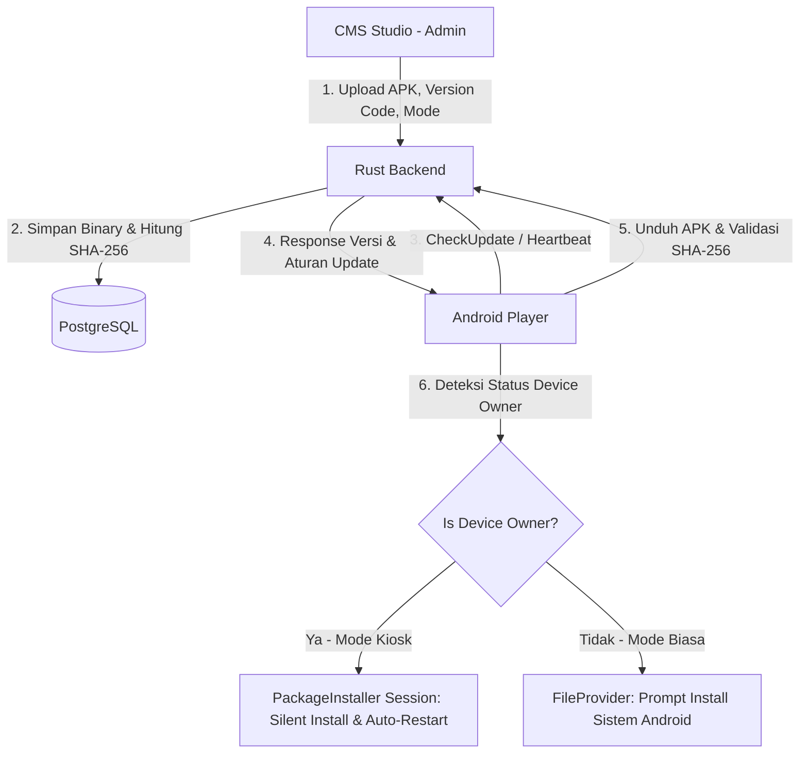

# Rencana Implementasi: Sistem Pembaruan APK OTA (Over-the-Air) & Kiosk Silent Update
**DKASigma Digital Signage Enterprise**

---

## 1. Ringkasan Eksekutif & Diagram Arsitektur

Fitur ini menyediakan infrastruktur terpadu untuk mendistribusikan berkas APK aplikasi Android secara terpusat dari CMS Studio ke seluruh perangkat signage di lapangan. Mendukung dua mode instalasi: **Kiosk Mode (Silent Background Update tanpa sentuhan manusia)** untuk perangkat produksi dan **Standard Mode (Prompt Dialog)** untuk perangkat pengujian.



---

## 2. Fase Implementasi

### Fase 1: Database & Protobuf Contract (Single Source of Truth)

1. **SQLx Migration Pair**:
   - `backend/migrations/XXXX_create_system_apk_releases.up.sql`:
     ```sql
     CREATE TABLE system_apk_releases (
         id UUID PRIMARY KEY DEFAULT gen_random_uuid(),
         version_code INT NOT NULL UNIQUE,
         version_name VARCHAR(50) NOT NULL,
         apk_file_url VARCHAR(500) NOT NULL,
         file_size_bytes BIGINT NOT NULL,
         sha256_hash VARCHAR(64) NOT NULL,
         release_notes TEXT,
         is_force_update BOOLEAN NOT NULL DEFAULT false,
         min_supported_version_code INT DEFAULT 1,
         is_active BOOLEAN NOT NULL DEFAULT true,
         created_at TIMESTAMPTZ NOT NULL DEFAULT NOW()
     );
     CREATE INDEX idx_apk_releases_version_code ON system_apk_releases(version_code DESC);
     CREATE INDEX idx_apk_releases_active ON system_apk_releases(is_active);
     ```
   - `backend/migrations/XXXX_create_system_apk_releases.down.sql`:
     ```sql
     DROP TABLE IF EXISTS system_apk_releases;
     ```

2. **Protobuf Contract (`backend/proto/system/v1/update/update.proto`)**:
   - Service `AppUpdateService`:
     - `GetLatestAppRelease(GetLatestReleaseRequest) returns (AppRelease)`
     - `ListAppReleases(ListAppReleasesRequest) returns (ListAppReleasesResponse)`
     - `CreateAppRelease(CreateAppReleaseRequest) returns (AppRelease)`
     - `DeleteAppRelease(DeleteAppReleaseRequest) returns (DeleteAppReleaseResponse)`
     - `CheckDeviceAppUpdate(CheckDeviceAppUpdateRequest) returns (CheckDeviceAppUpdateResponse)`
   - Sinkronisasi protobuf ke frontend (`bun scripts/generate_grpc.ts`) dan mirror ke Android (`android/app/src/main/proto/`).

---

### Fase 2: Backend Rust & Storage Engine

1. **Penyimpanan Berkas APK**:
   - Direktori penyimpanan: `/uploads/apks/`.
   - Streaming upload dengan ekstraksi ukuran file dan kalkulasi hash SHA-256 secara langsung (*zero-copy hashing*).
2. **Implementasi Service gRPC**:
   - `backend/src/grpc/system/update/service.rs`: logika query rilis aktif terbaru, perbandingan `current_version_code` perangkat vs `latest_version_code`, dan penentuan flag `is_force_update`.
3. **HTTP Binary Serving**:
   - Serving berkas APK dengan dukungan HTTP `Range` request (mendukung resume download saat koneksi seluler/Wi-Fi berfluktuasi).

---

### Fase 3: CMS Studio Management UI (Frontend Next.js)

1. **Halaman Daftar APK (`src/app/(dashboard)/system/apk/page.tsx`)**:
   - Desain Vanilla CSS HDR+ (`var(--bg-surface)`, `var(--border-subtle)`).
   - Tabel responsif: Versi (`version_name` & `version_code`), Tipe (`Paksa / Wajib` vs `Opsional`), Ukuran Berkas, Status Aktif, Tanggal Unggah.
   - Aksi: Hapus berkas, aktifkan/nonaktifkan rilis, dan unduh berkas APK.
2. **Halaman Upload APK (`src/app/(dashboard)/system/apk/create/page.tsx`)**:
   - Komponen upload drag-and-drop berkas `.apk`.
   - Input Nama Versi (e.g. `1.1.0`), Kode Versi integer (e.g. `12`), Catatan Rilis (*Release Notes*).
   - Toggle Switch: `Wajibkan Pembaruan (Force Update)`.
3. **Next.js Route Handler Bridge**:
   - `src/app/(api)/api/grpc/system/update/...` menghubungkan UI ke backend gRPC via helper `grpcClient.ts`.

---

### Fase 4: Android Player Updater Engine & Kiosk Execution

1. **UpdateChecker UseCase**:
   - Dijalankan saat aplikasi pertama kali boot dan terjadwal berkala (setiap 3–6 jam via watchdog ping).
   - Membandingkan `BuildConfig.VERSION_CODE` dengan `latest_version_code` dari CMS.

2. **Tampilan & Alur di Layar Player**:
   - **Mode Update Paksa (`is_force_update == true` atau `version < min_supported_version`)**:
     - Membuka overlay modal non-dismissable: *"Pembaruan Sistem Wajib (vX.Y.Z)"*.
     - Progress bar pengunduhan real-time (persentase, byte terunduh, total byte).
     - Otomatis melanjutkan ke tahap instalasi setelah lolos verifikasi hash SHA-256.
   - **Mode Opsi Pembaruan (`is_force_update == false`)**:
     - Menampilkan indikator / banner halus di layar atau tombol di dialog Pengaturan: *"Pembaruan vX.Y.Z Tersedia"*.
     - Dialog pilihan: **[Perbarui Sekarang]** dan **[Nanti]**.

3. **Mekanisme Eksekusi Hybrid (Smart Auto-Detection)**:
   ```kotlin
   val dpm = context.getSystemService(Context.DEVICE_POLICY_SERVICE) as DevicePolicyManager
   if (dpm.isDeviceOwnerApp(context.packageName)) {
       // Kiosk Production: Silent Install 100% otomatis tanpa sentuhan
       executeSilentPackageInstaller(apkFile)
   } else {
       // Development / Non-Device Owner: Prompt standar OS Android
       executeStandardPromptInstaller(apkFile)
   }
   ```

4. **Komponen Kiosk Mode (Silent Background Update)**:
   - **Receiver**: `SignageDeviceAdminReceiver` terdaftar di `AndroidManifest.xml` dengan hak `BIND_DEVICE_ADMIN`.
   - **Installer Session**: Menggunakan `PackageInstaller.Session` untuk men-stream data binary APK langsung ke internal package installer Android.
   - **Commit & Broadcast Receiver**: Menangani callback status instalasi (`STATUS_SUCCESS`).
   - **Auto-Restart**: Saat instalasi selesai, sistem secara otomatis meluncurkan kembali `PlayerActivity` versi terbaru.

---

## 3. Panduan Provisioning Perangkat Kiosk di Lapangan

Untuk mengaktifkan kemampuan instalasi senyap (*silent update*) pada perangkat produksi signage:

* **Metode 1: Perintah ADB (1x saat setup)**:
  ```bash
  adb shell dpm set-device-owner com.dkaapis.sigma/.receiver.SignageDeviceAdminReceiver
  ```
* **Metode 2: QR Provisioning (Android Enterprise)**:
  - Pada perangkat yang baru di-factory reset, ketuk layar 6 kali di layar "Welcome" untuk memindai payload JSON konfigurasi kiosk.

---

## 4. Matriks Verifikasi & Pengujian

| Komponen | Pengujian | Kriteria Keberhasilan |
|---|---|---|
| **CMS Studio** | Upload APK (30MB+) | Berkas tersimpan di `/uploads/apks/`, hash SHA-256 terhitung, entri tampil di tabel. |
| **Backend gRPC** | Query `CheckDeviceAppUpdate` | Mengembalikan `update_available=true` jika `version_code` perangkat lebih rendah. |
| **Android - Kiosk Mode** | Silent Background Update | APK terunduh, terinstall tanpa popup Android sama sekali, aplikasi restart otomatis ke versi baru. |
| **Android - Standard Mode** | Fallback non-Device Owner | Muncul prompt sistem konfirmasi pembaruan bawaan Android. |
| **Android - Force Mode** | Rilis wajib | Layar memblokir interaksi, download otomatis, lalu langsung dieksekusi. |
| **Integritas & Security** | Berkas APK rusak/tampered | Verifikasi SHA-256 mendeteksi ketidaksesuaian, berkas dihapus, instalasi digagalkan. |
