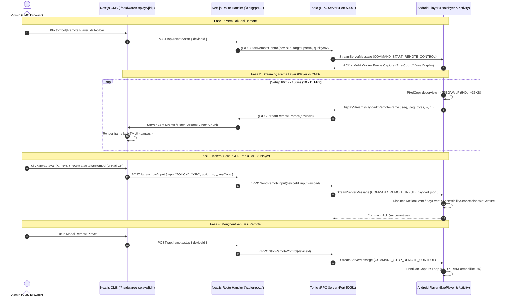

# Architectural Plan: DKASigma Remote Player (VNC / Web Remote Control)

## 1. Executive Summary & Objective

Fitur **Remote Player (VNC / Web Remote Control)** memungkinkan operator dan administrator di CMS Dashboard untuk:
1. **Melihat tampilan layar display secara live (Screen Mirroring)** dengan frame rate adaptif (5–15 FPS) langsung dari browser CMS tanpa perlu menyentuh fisik layar/STB.
2. **Melakukan kontrol interaktif (Virtual Touch & D-Pad Remote Control)** dengan mengklik/men-drag kanvas di browser atau menggunakan virtual remote (D-Pad Android TV, Back, Home, Menu, Volume) yang langsung dieksekusi di perangkat display.
3. **Membantu troubleshooting & setup jarak jauh** seperti pengaturan volume, navigasi menu, bypass dialog sistem Android TV, atau verifikasi konten visual tanpa perlu datang ke lokasi fisik display.

---

## 2. End-to-End Architecture Diagram



---

## 3. Komponen Protobuf Contract (`backend/proto/`)

Mengikuti **Non-Negotiable Protobuf Contract Rule**, seluruh schema transmisi didaftarkan di `backend/proto/distribution/v1/stream/`:

### A. Update `stream.common.proto`

```protobuf
enum ServerCommandType {
  COMMAND_UNSPECIFIED = 0;
  COMMAND_RELOAD_MANIFEST = 1;
  COMMAND_CAPTURE_SCREENSHOT = 2;
  COMMAND_REBOOT_PLAYER = 3;
  COMMAND_EMERGENCY_BROADCAST = 4;
  COMMAND_CLEAR_CACHE = 5;
  COMMAND_START_REMOTE_CONTROL = 6;  // Perintah mulai streaming frame
  COMMAND_STOP_REMOTE_CONTROL = 7;   // Perintah hentikan streaming frame
  COMMAND_REMOTE_INPUT = 8;          // Perintah kirim sentuhan / tombol remote
}

// Payload input sentuh dan tombol dari CMS ke Player
message RemoteInputEvent {
  enum InputType {
    TYPE_TOUCH = 0;
    TYPE_KEY = 1;
  }
  enum TouchAction {
    ACTION_DOWN = 0;
    ACTION_MOVE = 1;
    ACTION_UP = 2;
  }
  enum KeyCode {
    KEY_UNSPECIFIED = 0;
    KEY_DPAD_UP = 19;
    KEY_DPAD_DOWN = 20;
    KEY_DPAD_LEFT = 21;
    KEY_DPAD_RIGHT = 22;
    KEY_DPAD_CENTER = 23;  // OK / Enter
    KEY_BACK = 4;
    KEY_HOME = 3;
    KEY_MENU = 82;
    KEY_VOLUME_UP = 24;
    KEY_VOLUME_DOWN = 25;
    KEY_VOLUME_MUTE = 164;
  }

  InputType input_type = 1;
  TouchAction touch_action = 2;
  float normalized_x = 3; // 0.0 sampai 1.0 (persentase lebar layar)
  float normalized_y = 4; // 0.0 sampai 1.0 (persentase tinggi layar)
  KeyCode key_code = 5;
}

// Payload frame dari Player ke Server gRPC
message RemoteFramePayload {
  int64 sequence_number = 1;
  int64 timestamp_ms = 2;
  bytes frame_bytes = 3;      // Kompresi JPEG atau WebP
  string mime_type = 4;       // "image/jpeg" atau "image/webp"
  int32 width = 5;
  int32 height = 6;
}

// Tambahkan ke StreamClientMessage.oneof payload
message StreamClientMessage {
  string device_id = 1;
  string device_token = 2;
  int64 timestamp = 3;
  oneof payload {
    HeartbeatPing ping = 4;
    CommandAck command_ack = 5;
    ScreenshotUpload screenshot = 6;
    RemoteFramePayload remote_frame = 7; // <- FRAME LIVE VNC
  }
}
```

### B. Update `stream.proto`

```protobuf
service StreamService {
  // Bi-directional streaming yang sudah ada
  rpc DisplayStream(stream StreamClientMessage) returns (stream StreamServerMessage);

  // Endpoint RPC untuk CMS Operator:
  rpc StartRemoteControl(StartRemoteControlRequest) returns (StartRemoteControlResponse);
  rpc StopRemoteControl(StopRemoteControlRequest) returns (StopRemoteControlResponse);
  rpc SendRemoteInput(SendRemoteInputRequest) returns (SendRemoteInputResponse);
  rpc StreamRemoteFrames(StreamRemoteFramesRequest) returns (stream RemoteFramePayload);
}
```

---

## 4. Implementasi Backend Rust (`backend/`)

1. **`StreamConnectionManager` Extension:**
   - Menyimpan `broadcast::channel<RemoteFramePayload>` aktif untuk setiap `device_id` yang sedang dalam sesi remote.
   - Menerima `Payload::RemoteFrame` dari gRPC stream player dan mem-broadcast ke channel tersebut.
   - Jika tidak ada subscriber CMS yang menonton selama >30 detik, otomatis kirim `COMMAND_STOP_REMOTE_CONTROL` ke player untuk mencegah pemborosan bandwidth.
2. **`SendRemoteInput` Service Handler:**
   - Memvalidasi permission user CMS (`can_manage_devices`).
   - Meneruskan `RemoteInputEvent` ke `DisplayStream` player yang sesuai via mpsc sender.
3. **`StreamRemoteFrames` Service Handler:**
   - Membuka streaming subscription ke broadcast channel frame perangkat yang diminta.

---

## 5. Implementasi Android Player (`android/`)

1. **Worker Penangkap Layar (`PlayerRemoteScreenCapture`):**
   - **Teknologi:** `PixelCopy.request(window, bitmap, ...)` (tersedia di API 26+ Android TV).
   - **Optimasi Resolusi:** Resolusi layar 1080p/4K di-downscale ke resolusi streaming yang ringan (contoh: 960x540 atau 640x360).
   - **Kompresi:** Dikompresi menggunakan `Bitmap.CompressFormat.JPEG` dengan quality 65–70%.
   - **Ukuran per frame:** ~25–35 KB.
   - **Throughput pada 10 FPS:** ~300 KB/s (sangat ringan untuk LAN maupun koneksi 4G/WiFi).
   - **Liveness:** Hanya aktif saat `isRemoteSessionActive == true`. Begitu sesi ditutup, thread/coroutine capture langsung dihentikan.
2. **Worker Eksekusi Input (`PlayerRemoteInputInjector`):**
   - **In-App Touch / Click:**
     ```kotlin
     val x = normalizedX * decorView.width
     val y = normalizedY * decorView.height
     val motionEvent = MotionEvent.obtain(downTime, eventTime, action, x, y, 0)
     decorView.dispatchTouchEvent(motionEvent)
     ```
   - **In-App Keys (D-Pad & Navigation):**
     ```kotlin
     val keyEvent = KeyEvent(KeyEvent.ACTION_DOWN, keyCode)
     decorView.dispatchKeyEvent(keyEvent)
     decorView.dispatchKeyEvent(KeyEvent(KeyEvent.ACTION_UP, keyCode))
     ```
   - **System-Wide Accessibility Fallback:**
     Jika `KioskAccessibilityService` diaktifkan oleh pengguna, player dapat memanggil `KioskAccessibilityService.dispatchGesture(...)` untuk mengklik koordinat di level OS (misal: menutup dialog OS sistem atau mengklik popup).

---

## 6. Implementasi CMS Frontend Next.js (`frontend/`)

1. **UI Komponen Toolbar di Detail Display (`DisplayCommandToolbar.tsx`):**
   - Menambahkan tombol **`[Remote Player]`** dengan icon `MonitorPlay` / `Tv2` di sebelah tombol `[Screenshot]`.
   - Warna tombol: Secondary / Accent (aktif jika perangkat online).
2. **Modal Viewer Interaktif (`RemotePlayerModal.tsx`):**
   - **Sisi Kiri / Utama: Layar Kanvas Live**
     - Menggunakan `<canvas>` dengan `aspect-ratio: 16/9`.
     - Frame diterima via SSE (`/api/grpc/distribution/stream/StreamRemoteFrames`) dan digambar ke kanvas dengan `ctx.drawImage()`.
     - Listener mouse: `onMouseDown`, `onMouseMove`, `onMouseUp` yang menghitung posisi relatif `(offsetX / clientWidth)` dan mengirim payload touch secara instan.
     - Indikator FPS live, resolusi, dan latency (ms).
   - **Sisi Kanan: Panel Virtual D-Pad Remote Control**
     - Tombol Navigasi TV: **UP, DOWN, LEFT, RIGHT, OK** (berbentuk lingkaran D-Pad khas remote Android TV).
     - Tombol Navigasi Sistem: **BACK, HOME, MENU**.
     - Tombol Kontrol Volume: **VOL +, VOL -, MUTE**.
     - Tombol Pintasan Cepat: **Buka Pengaturan Player, Sync Konten, Reboot**.

---

## 7. Rencana Tahapan Eksekusi (Implementation Milestones)

| Fase | Deskripsi Kerja | Estimasi File Terkait |
|---|---|---|
| **Fase 1** | **Protobuf Contracts & Code Gen**<br>Menambahkan command `START/STOP_REMOTE_CONTROL`, `REMOTE_INPUT`, dan `RemoteFramePayload` di proto distribution. Menjalankan code generator. | `stream.proto`, `stream.common.proto` |
| **Fase 2** | **Backend gRPC Routing & Multiplexer**<br>Menambahkan channel broadcast frame dan handler `StartRemoteControl`, `StopRemoteControl`, `SendRemoteInput`, `StreamRemoteFrames`. | `backend/.../stream/service.rs`, `StreamConnectionManager.rs` |
| **Fase 3** | **Android Player Screen Streamer & Injector**<br>Membuat `PlayerRemoteCaptureWorker.kt` (PixelCopy loop) dan `PlayerRemoteInputInjector.kt` (dispatch Touch & Key). Mengintegrasikannya ke `PlayerStreamManager.kt`. | `PlayerStreamManager.kt`, `PlayerActivity.kt`, `KioskAccessibilityService.kt` |
| **Fase 4** | **Frontend CMS Modal & Virtual Remote**<br>Membuat komponen `RemotePlayerModal.tsx` dengan kanvas interaktif dan virtual D-Pad. Menghubungkan tombol di `DisplayCommandToolbar.tsx`. | `DisplayCommandToolbar.tsx`, `RemotePlayerModal.tsx`, route handlers |
| **Fase 5** | **Verifikasi & Performance Benchmark**<br>Uji latensi respon sentuhan, stabilitas RAM/CPU Android TV box saat streaming frame, dan auto-cleanup saat browser ditutup. | Manual testing & logging |

---

## 8. Analisis Risiko & Mitigasi

1. **Risiko Bottleneck Bandwidth & Beban CPU Android Player:**
   * *Mitigasi:* Frame rate dibatasi maksimal 10–12 FPS dan resolusi diturunkan ke 540p (960x540). Sesi otomatis berhenti (*timeout*) jika tidak ada operator aktif yang menonton selama 30 detik.
2. **Risiko Keamanan (Akses Tak Terotorisasi):**
   * *Mitigasi:* Seluruh endpoint Remote Control wajib melewati `require_permission("can_manage_devices")` dengan JWT token admin yang valid.
3. **Keterbatasan Layar Hardware SurfaceView:**
   * *Mitigasi:* Menggunakan `PixelCopy` API pada level Window (yang sudah terbukti berhasil di fungsi `PlayerScreenshotHelper`), bukan `View.draw(Canvas)`, sehingga video ExoPlayer tetap terlihat jelas dan tidak menjadi kotak hitam.
