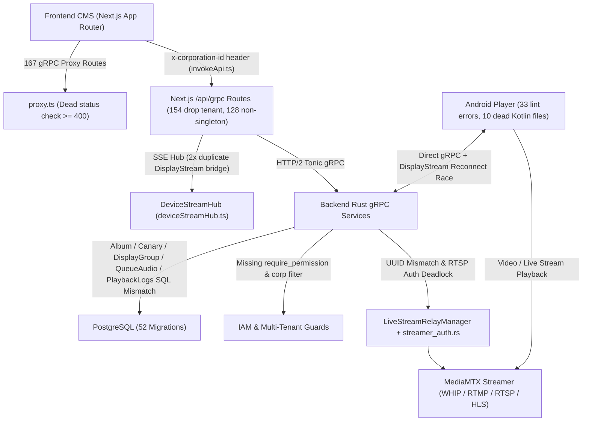

# Peta Status Proyek & Rencana Audit Perbaikan — HNDSigma Digital Signage

> [!IMPORTANT]
> Dokumen ini merangkum pemetaan knowledge graph `/graphify` pada commit `5d0734f6` serta hasil audit lintas modul (`backend/`, `frontend/`, `android/`, `backend/migrations/`) untuk mendeteksi modul rusak/setengah jadi, bug runtime, celah RBAC & multi-tenancy, lint error, inkonsistensi dokumentasi, dan dead code.

---

## 1. Peta Status Proyek Saat Ini (Graphify & Verifikasi Kompilasi)

### Ringkasan Graphify ([GRAPH_REPORT.md](file:///Users/yovangga/WORKSPACE/DKA/PRODUCT/SIGNAGE/graphify-out/GRAPH_REPORT.md))
- **Commit referensi**: `5d0734f6` (diperbarui pada `2026-11-14`)
- **Ukuran korpus**: **996 berkas** · ~316.042 kata (`949` berkas kode, `37` dokumen, `10` gambar)
- **Struktur Graph**: **5.571 nodes** · **13.506 edges** · **432 communities**
  - Visualisasi interaktif teragregasi tersedia di [graph.html](file:///Users/yovangga/WORKSPACE/DKA/PRODUCT/SIGNAGE/graphify-out/graph.html) dan data mentah di [graph.json](file:///Users/yovangga/WORKSPACE/DKA/PRODUCT/SIGNAGE/graphify-out/graph.json).
  - Catatan diagnostik ekstraksi: `0` *missing-endpoint edges*, `1.745` *dangling-endpoint edges* (referensi ke simbol eksternal/std/proto), `75` *self-loop edges*, `482` *collapsed undirected edges*.
- **God Nodes Utama (Abstraksi dengan Koneksi Tertinggi)**:
  - `getGrpcMetadata()` (`313` edges) dan `getTokenFromRequest()` (`313` edges) — [grpcClient.ts](file:///Users/yovangga/WORKSPACE/DKA/PRODUCT/SIGNAGE/frontend/src/lib/core/grpcClient.ts#L41-L66)
  - `getGrpcHost()` (`270` edges) dan `getGrpcCredentials()` (`270` edges) — [grpcClient.ts](file:///Users/yovangga/WORKSPACE/DKA/PRODUCT/SIGNAGE/frontend/src/lib/core/grpcClient.ts#L3-L17)
  - `Status` (`231` edges, `tonic::Status`) dan `AppError` (`140` edges) — tulang punggung penanganan error gRPC di Backend Rust
  - `next` (`305` edges), `react` (`208` edges), `lucide-react` (`163` edges), `PageLoadingSkeleton()` (`152` edges)
- **Bridges Kritis Non-AST yang Terdeteksi**:
  - `StreamConnectionManager` — [services.rs](file:///Users/yovangga/WORKSPACE/DKA/PRODUCT/SIGNAGE/backend/src/modules/distribution/stream/services.rs#L155-L182)
  - `LiveStreamRelayManager` — [live_stream_relay.rs](file:///Users/yovangga/WORKSPACE/DKA/PRODUCT/SIGNAGE/backend/src/workers/live_stream_relay.rs#L110-L205)
  - `DeviceStreamHub` — [deviceStreamHub.ts](file:///Users/yovangga/WORKSPACE/DKA/PRODUCT/SIGNAGE/frontend/src/lib/core/deviceStreamHub.ts#L7-L178)

### Status Pemeriksaan Kompilasi & Lint Saat Ini
| Lapisan | Perintah / Sumber | Status | Catatan |
|---|---|---|---|
| **Backend (Rust)** | `cd backend && cargo check` | Lulus (`0` error, `0` warning) | Menggunakan `sqlx::query` / `sqlx::query_as` runtime sehingga mismatch nama/tipe kolom SQL baru meledak saat runtime. |
| **Frontend (Next.js / TS)** | `cd frontend && bun tsc --noEmit` | Lulus (`0` error) | — |
| **Android (Kotlin)** | [lint-results-debug.txt](file:///Users/yovangga/WORKSPACE/DKA/PRODUCT/SIGNAGE/android/app/build/reports/lint-results-debug.txt#L1157-L1159) | Gagal (`33` errors, `226` warnings) | 29 error `UnsafeOptInUsageError` di `VideoZoneRenderer.kt` + 4 error lain memblokir `:app:check`. |
| **Database Migrations** | [migrations/](file:///Users/yovangga/WORKSPACE/DKA/PRODUCT/SIGNAGE/backend/migrations) | `52` pasang (`0001`–`0052`) | Ada selisih kolom antara skema tabel vs query/entity Rust di 6 area. |

### Arsitektur & Zona Bermasalah

---

## 2. Kategori 1 — Modul Rusak / Setengah Jadi & Bug Kritis (Prioritas P0)

> [!CAUTION]
> Temuan pada bagian ini lulus `cargo check` / `tsc --noEmit`, tetapi **pasti gagal saat dijalankan** di runtime atau menyebabkan hilangnya isolasi data / putusnya koneksi real-time.

### P0.1 — Modul Photo Album Rusak Total (`AlbumServiceImpl` vs Migrasi `0030` & `0031`)
- **Berkas**: [service.rs](file:///Users/yovangga/WORKSPACE/DKA/PRODUCT/SIGNAGE/backend/src/grpc/components/album/service.rs#L17-L340), [0030_create_components_albums.up.sql](file:///Users/yovangga/WORKSPACE/DKA/PRODUCT/SIGNAGE/backend/migrations/0030_create_components_albums.up.sql#L1-L16), [0031_create_components_album_photos.up.sql](file:///Users/yovangga/WORKSPACE/DKA/PRODUCT/SIGNAGE/backend/migrations/0031_create_components_album_photos.up.sql#L1-L15)
- **Akar Masalah**:
  1. `create_album` ([service.rs](file:///Users/yovangga/WORKSPACE/DKA/PRODUCT/SIGNAGE/backend/src/grpc/components/album/service.rs#L162-L175)) mengeksekusi `INSERT INTO components_albums (id, name, description, transition_effect, slide_duration_seconds)` **tanpa `corporation_id`**, padahal di `0030` kolom `corporation_id UUID NOT NULL` tanpa nilai default -> gagal `NOT NULL constraint violation`.
  2. `fetch_album_detail` ([service.rs](file:///Users/yovangga/WORKSPACE/DKA/PRODUCT/SIGNAGE/backend/src/grpc/components/album/service.rs#L79-L89)), `create_album` ([L180-L185](file:///Users/yovangga/WORKSPACE/DKA/PRODUCT/SIGNAGE/backend/src/grpc/components/album/service.rs#L180-L185)), `update_album` ([L280-L285](file:///Users/yovangga/WORKSPACE/DKA/PRODUCT/SIGNAGE/backend/src/grpc/components/album/service.rs#L280-L285)), dan `AlbumPhotoServiceImpl::add_album_photo` ([L326-L331](file:///Users/yovangga/WORKSPACE/DKA/PRODUCT/SIGNAGE/backend/src/grpc/components/album/service.rs#L326-L331)) membaca/menulis kolom fiktif **`position`**, **`promo_badge`**, dan **`price_tag`** pada `components_album_photos` serta tidak menyertakan `corporation_id`. Di migrasi `0031`, kolom riil yang ada adalah **`order_index`** dan **`caption`** (beserta `corporation_id UUID NOT NULL`).
  3. `AlbumRow.description` ([service.rs](file:///Users/yovangga/WORKSPACE/DKA/PRODUCT/SIGNAGE/backend/src/grpc/components/album/service.rs#L21)) bertipe `String`, sedangkan di `0030` `description` bertipe `TEXT` nullable -> rawan `ColumnDecodeError`.

### P0.2 — Modul Display Group Gagal Create & Mapping Setengah Jadi
- **Berkas**: [repositories.rs](file:///Users/yovangga/WORKSPACE/DKA/PRODUCT/SIGNAGE/backend/src/modules/hardware/display_group/repositories.rs#L8-L29), [service.rs](file:///Users/yovangga/WORKSPACE/DKA/PRODUCT/SIGNAGE/backend/src/grpc/hardware/display_group/service.rs#L24-L36), [0017_create_hardware_display_groups.up.sql](file:///Users/yovangga/WORKSPACE/DKA/PRODUCT/SIGNAGE/backend/migrations/0017_create_hardware_display_groups.up.sql#L1-L13)
- **Akar Masalah**:
  - `DisplayGroupRepository::create` menyisipkan `(name, description, default_layout_id, schedule_id, schedule_assigned_at)` **tanpa `corporation_id`**, padahal `0017` mendefinisikan `corporation_id UUID NOT NULL`.
  - `DisplayGroupServiceImpl::map_entity` menyisakan placeholder setengah jadi `default_layout_name: "".to_string(), // will be populated via join if needed` dan `schedule_name: "".to_string()`.

### P0.3 — Modul Canary Group Rusak Total (`CanaryRepository` vs Migrasi `0012`)
- **Berkas**: [model.rs](file:///Users/yovangga/WORKSPACE/DKA/PRODUCT/SIGNAGE/backend/src/modules/distribution/canary/model.rs#L6-L25), [repositories.rs](file:///Users/yovangga/WORKSPACE/DKA/PRODUCT/SIGNAGE/backend/src/modules/distribution/canary/repositories.rs#L8-L65), [0012_create_distribution_canary_groups.up.sql](file:///Users/yovangga/WORKSPACE/DKA/PRODUCT/SIGNAGE/backend/migrations/0012_create_distribution_canary_groups.up.sql#L1-L12)
- **Akar Masalah**: `CanaryGroupEntity`, `CreateCanaryGroupDto`, dan query `INSERT`/`UPDATE` di `CanaryRepository` memakai kolom fiktif **`target_layout_id`** yang tidak ada di tabel `distribution_canary_groups`, serta `create` tidak menyertakan **`corporation_id` (`NOT NULL`)**.

### P0.4 — RPC `AssignLayoutToDevice` Rusak (`ManifestRepository` vs Migrasi `0034`)
- **Berkas**: [repositories.rs](file:///Users/yovangga/WORKSPACE/DKA/PRODUCT/SIGNAGE/backend/src/modules/distribution/manifest/repositories.rs#L7-L36), [0034_create_hardware_device_layouts.up.sql](file:///Users/yovangga/WORKSPACE/DKA/PRODUCT/SIGNAGE/backend/migrations/0034_create_hardware_device_layouts.up.sql#L1-L9)
- **Akar Masalah**: `ManifestRepository::assign_layout_to_device` menjalankan `INSERT INTO hardware_device_layouts (device_id, layout_id, is_active, corporation_id)`, padahal tabel `hardware_device_layouts` tidak memiliki kolom `is_active`.

### P0.5 — RPC `QueueAudioService::add_audio` Gagal & Silent Error di `update_queue_display`
- **Berkas**: [service.rs](file:///Users/yovangga/WORKSPACE/DKA/PRODUCT/SIGNAGE/backend/src/grpc/components/queue/service.rs#L841-L873) & [L1910-L1947](file:///Users/yovangga/WORKSPACE/DKA/PRODUCT/SIGNAGE/backend/src/grpc/components/queue/service.rs#L1910-L1947), [0040_create_components_queue_audios.up.sql](file:///Users/yovangga/WORKSPACE/DKA/PRODUCT/SIGNAGE/backend/migrations/0040_create_components_queue_audios.up.sql#L1-L15)
- **Akar Masalah**:
  - `QueueAudioService::add_audio` tidak menyisipkan `corporation_id` (`UUID NOT NULL` pada `components_queue_audios`).
  - Pada `update_queue_display` ([L842-L872](file:///Users/yovangga/WORKSPACE/DKA/PRODUCT/SIGNAGE/backend/src/grpc/components/queue/service.rs#L842-L872)), query `DELETE` dan `INSERT` audio memakai `.ok()` sehingga error PostgreSQL ditelan diam-diam.

### P0.6 — `StreamService::list_playback_logs` Crash (`i64` vs `UUID`) & Duplikasi Kolom FK
- **Berkas**: [service.rs](file:///Users/yovangga/WORKSPACE/DKA/PRODUCT/SIGNAGE/backend/src/grpc/distribution/stream/service.rs#L391-L429), [0042_create_distribution_playback_logs.up.sql](file:///Users/yovangga/WORKSPACE/DKA/PRODUCT/SIGNAGE/backend/migrations/0042_create_distribution_playback_logs.up.sql#L1-L14)
- **Akar Masalah**:
  - `list_playback_logs` mendeklarasikan `struct Row { id: i64, ... }`, sedangkan kolom `id` pada `distribution_playback_logs` bertipe `UUID`. Begitu ada baris log pemutaran, RPC langsung gagal dengan `ColumnDecodeError`.
  - Migrasi `0042` juga mendefinisikan dua kolom foreign key redundan (`media_item_id` dan `media_id`) yang keduanya merujuk `studio_media_items(id)`.

### P0.7 — Live Stream: Mismatch UUID Saat Create & Deadlock Autentikasi Relay RTSP
- **Berkas**: [LiveStreamEditorContext.tsx](file:///Users/yovangga/WORKSPACE/DKA/PRODUCT/SIGNAGE/frontend/src/app/(dashboard)/studio/components/livestream/context/LiveStreamEditorContext.tsx#L146-L151) & [L262-L329](file:///Users/yovangga/WORKSPACE/DKA/PRODUCT/SIGNAGE/frontend/src/app/(dashboard)/studio/components/livestream/context/LiveStreamEditorContext.tsx#L262-L329), [service.rs](file:///Users/yovangga/WORKSPACE/DKA/PRODUCT/SIGNAGE/backend/src/grpc/components/live_stream/service.rs#L88-L145), [live_stream_relay.rs](file:///Users/yovangga/WORKSPACE/DKA/PRODUCT/SIGNAGE/backend/src/workers/live_stream_relay.rs#L110-L195), [streamer_auth.rs](file:///Users/yovangga/WORKSPACE/DKA/PRODUCT/SIGNAGE/backend/src/streamer_auth.rs#L24-L69)
- **Akar Masalah**:
  1. **UUID Mismatch saat Create**: Saat mode create (`!initialStreamId`), frontend menghasilkan `generatedKey` UUID acak untuk menyusun `sourceUrl` (`/streams/${streamKey}/whip` atau `/live/${streamKey}`). Saat `create_live_stream` dipanggil, backend menghasilkan **`id = Uuid::new_v4()` baru** untuk `server_hls_endpoint` (`/streams/{id}/live.m3u8`), tetapi menyimpan `req.source_url` yang memakai UUID lama dari frontend. URL ingest WHIP/RTMP sebelum save pun tidak sinkron dengan `id` database dan ditolak `404` oleh `streamer_auth.rs`.
  2. **RTSP Auth Deadlock**: Saat `sourceType === 'RTSP'` dengan kamera berpassword (`requires_auth = true`, `ingest_username`, `ingest_password`), `LiveStreamRelayManager::start_relay` (a) tidak menyisipkan kredensial kamera ke URL `-i` FFmpeg, dan (b) ketika FFmpeg mem-publish hasil transkode ke `rtsp://dka-product-sigma-streamer:8554/live/{stream_id}`, MediaMTX memanggil `/api/streamer/auth` (`action: "publish"`) dan [authorize](file:///Users/yovangga/WORKSPACE/DKA/PRODUCT/SIGNAGE/backend/src/streamer_auth.rs#L53-L61) mengembalikan `401 UNAUTHORIZED` karena FFmpeg internal tidak mengirim kredensial `live_streams`.

### P0.8 — Impersonasi Multi-Tenant (`x-corporation-id`) Terbuang di 154 dari 167 Route Next.js
- **Berkas**: [invokeApi.ts](file:///Users/yovangga/WORKSPACE/DKA/PRODUCT/SIGNAGE/frontend/src/lib/core/invokeApi.ts#L12-L15), [grpcClient.ts](file:///Users/yovangga/WORKSPACE/DKA/PRODUCT/SIGNAGE/frontend/src/lib/core/grpcClient.ts#L41-L80), dan `frontend/src/app/(api)/api/grpc/**/route.ts`
- **Akar Masalah**: `invokeApi.ts` menyertakan header `x-corporation-id` untuk fitur impersonasi Superadmin. Namun dari **167** file `route.ts`, hanya **10** route yang memanggil `getGrpcMetadataFromRequest(req)`, sementara **154** route masih memanggil `getGrpcMetadata(token)` tanpa `corporationId`, sehingga konteks tenant impersonasi hilang sebelum mencapai backend gRPC.

### P0.9 — Race Condition Reconnect `DisplayStream` Menandai Player Online Jadi Offline
- **Berkas**: [services.rs](file:///Users/yovangga/WORKSPACE/DKA/PRODUCT/SIGNAGE/backend/src/modules/distribution/stream/services.rs#L167-L182), [service.rs](file:///Users/yovangga/WORKSPACE/DKA/PRODUCT/SIGNAGE/backend/src/grpc/distribution/stream/service.rs#L243-L258)
- **Akar Masalah**: `StreamConnectionManager::unregister_connection(&id)` menghapus entry `device_id` dari `active_displays` tanpa memverifikasi bahwa `CommandSender` yang putus adalah koneksi terbaru (`same_channel`), lalu `display_stream` langsung memanggil `set_device_online_state(..., false)`. Jika player Android sempat putus lalu reconnect sebelum koneksi lama mati (timeout 45 detik), berakhirnya koneksi lama akan menghapus koneksi baru dan memaksa status perangkat menjadi `is_online = false`.

### P0.10 — Koneksi Ganda Backend `DisplayStream` di `deviceStreamHub.ts` (Event SSE Terkirim 2x)
- **Berkas**: [deviceStreamHub.ts](file:///Users/yovangga/WORKSPACE/DKA/PRODUCT/SIGNAGE/frontend/src/lib/core/deviceStreamHub.ts#L11-L13), [L122](file:///Users/yovangga/WORKSPACE/DKA/PRODUCT/SIGNAGE/frontend/src/lib/core/deviceStreamHub.ts#L122), [L127-L178](file:///Users/yovangga/WORKSPACE/DKA/PRODUCT/SIGNAGE/frontend/src/lib/core/deviceStreamHub.ts#L127-L178)
- **Akar Masalah**: Konstruktor `DeviceStreamHub` memanggil `this.ensureBackendStreamBridge()` (`L12`), **dan** baris `178` memanggil `startGlobalBackendStreamBridge()`. Keduanya membuat klien gRPC `displayStream()` terpisah dengan nama `web-sse-bridge`, sehingga setiap pesan real-time dari backend diteruskan ke seluruh subscriber SSE sebanyak **2 kali**.

---

## 3. Kategori 2 — Celah Keamanan, Permission RBAC & Isolasi Multi-Tenant (Prioritas P1)

> [!WARNING]
> Layanan di bawah ini membuka operasi tulis/hapus/baca lintas tenant tanpa pemeriksaan RBAC (`require_permission`) maupun filter `corporation_id` dari token JWT.

### P1.1 — Layanan gRPC Tanpa Pemeriksaan `require_permission`
- **Tanpa `require_permission` sama sekali (`0` panggilan)**:
  - System OTA APK: [update/service.rs](file:///Users/yovangga/WORKSPACE/DKA/PRODUCT/SIGNAGE/backend/src/grpc/system/update/service.rs) (`create_app_release`, `delete_app_release`, `toggle_app_release_active`, `get_app_release`, `list_app_releases`, dll.)
  - Components: [album/service.rs](file:///Users/yovangga/WORKSPACE/DKA/PRODUCT/SIGNAGE/backend/src/grpc/components/album/service.rs), [clock/service.rs](file:///Users/yovangga/WORKSPACE/DKA/PRODUCT/SIGNAGE/backend/src/grpc/components/clock/service.rs), [ticker/service.rs](file:///Users/yovangga/WORKSPACE/DKA/PRODUCT/SIGNAGE/backend/src/grpc/components/ticker/service.rs), [webview/service.rs](file:///Users/yovangga/WORKSPACE/DKA/PRODUCT/SIGNAGE/backend/src/grpc/components/webview/service.rs), [live_stream/service.rs](file:///Users/yovangga/WORKSPACE/DKA/PRODUCT/SIGNAGE/backend/src/grpc/components/live_stream/service.rs)
  - Common & Studio: [orientation/service.rs](file:///Users/yovangga/WORKSPACE/DKA/PRODUCT/SIGNAGE/backend/src/grpc/common/orientation/service.rs), [resolution/service.rs](file:///Users/yovangga/WORKSPACE/DKA/PRODUCT/SIGNAGE/backend/src/grpc/common/resolution/service.rs), [item_override/service.rs](file:///Users/yovangga/WORKSPACE/DKA/PRODUCT/SIGNAGE/backend/src/grpc/studio/layer/item_override/service.rs), [transition/service.rs](file:///Users/yovangga/WORKSPACE/DKA/PRODUCT/SIGNAGE/backend/src/grpc/studio/transition/service.rs), [visual_filter/service.rs](file:///Users/yovangga/WORKSPACE/DKA/PRODUCT/SIGNAGE/backend/src/grpc/studio/visual_filter/service.rs)
  - Speech TTS: [tts/service.rs](file:///Users/yovangga/WORKSPACE/DKA/PRODUCT/SIGNAGE/backend/src/grpc/speech/tts/service.rs) (`synthesize`)
- **Hanya sebagian RPC yang terlindungi**:
  - [queue/service.rs](file:///Users/yovangga/WORKSPACE/DKA/PRODUCT/SIGNAGE/backend/src/grpc/components/queue/service.rs): hanya `3` panggilan `require_permission`, sedangkan operasi sensitif (`delete_queue_display`, `save_queue_layout`, `add_counter`, `update_counter`, `delete_counter`, `reset_queue`, `add_audio`, `delete_audio`, dll.) belum dilindungi.
  - [device/service.rs](file:///Users/yovangga/WORKSPACE/DKA/PRODUCT/SIGNAGE/backend/src/grpc/hardware/device/service.rs): `get_device_analytics_history` belum memanggil `require_permission`.
  - [canary/service.rs](file:///Users/yovangga/WORKSPACE/DKA/PRODUCT/SIGNAGE/backend/src/grpc/distribution/canary/service.rs#L146-L175): `evaluate_canary` belum memanggil `require_permission`.

### P1.2 — Kebocoran Isolasi Multi-Tenant (`corporation_id`)
- [clock/service.rs](file:///Users/yovangga/WORKSPACE/DKA/PRODUCT/SIGNAGE/backend/src/grpc/components/clock/service.rs#L107) dan [ticker/service.rs](file:///Users/yovangga/WORKSPACE/DKA/PRODUCT/SIGNAGE/backend/src/grpc/components/ticker/service.rs#L79) masih memakai fallback `COALESCE((SELECT id FROM system_corporations LIMIT 1), '00000000-0000-0000-0000-000000000000'::uuid)` dan tidak memfilter `corporation_id` pada query list/get/update/delete.
- [live_stream/service.rs](file:///Users/yovangga/WORKSPACE/DKA/PRODUCT/SIGNAGE/backend/src/grpc/components/live_stream/service.rs#L106-L195) tidak mengambil `corporation_id` dari `Claims` (jatuh ke default migrasi `0050`: `...0001`), dan `list_live_streams` (`L188`) tidak memfilter `corporation_id`.
- [webview/service.rs](file:///Users/yovangga/WORKSPACE/DKA/PRODUCT/SIGNAGE/backend/src/grpc/components/webview/service.rs), [display_group/service.rs](file:///Users/yovangga/WORKSPACE/DKA/PRODUCT/SIGNAGE/backend/src/grpc/hardware/display_group/service.rs), [canary/service.rs](file:///Users/yovangga/WORKSPACE/DKA/PRODUCT/SIGNAGE/backend/src/grpc/distribution/canary/service.rs), dan [update/service.rs](file:///Users/yovangga/WORKSPACE/DKA/PRODUCT/SIGNAGE/backend/src/grpc/system/update/service.rs) belum memfilter berdasarkan `corporation_id` dari `Claims`.

### P1.3 — Jebakan `ColumnDecodeError` Kolom Nullable pada Struct Rust
Kolom nullable (atau tidak bertanda `NOT NULL`) di PostgreSQL dipetakan ke tipe non-`Option` pada struct `sqlx::FromRow`:
- `QueueLayoutItemRow.template_content: String` di [queue/service.rs](file:///Users/yovangga/WORKSPACE/DKA/PRODUCT/SIGNAGE/backend/src/grpc/components/queue/service.rs#L79-L94) vs `template_content TEXT` di [0037_create_components_queue_layout_items.up.sql](file:///Users/yovangga/WORKSPACE/DKA/PRODUCT/SIGNAGE/backend/migrations/0037_create_components_queue_layout_items.up.sql#L17).
- `DeviceEntity` (`screen_width`, `screen_height`, `orientation`, `storage_total_bytes`, `storage_free_bytes`) di [device/model.rs](file:///Users/yovangga/WORKSPACE/DKA/PRODUCT/SIGNAGE/backend/src/modules/hardware/device/model.rs#L15-L25) vs [0018_create_hardware_devices.up.sql](file:///Users/yovangga/WORKSPACE/DKA/PRODUCT/SIGNAGE/backend/migrations/0018_create_hardware_devices.up.sql#L11-L26) (punya `DEFAULT`, tetapi tidak `NOT NULL`).
- `LayerBlockEntity.trim_start_seconds: i32` di [block/model.rs](file:///Users/yovangga/WORKSPACE/DKA/PRODUCT/SIGNAGE/backend/src/modules/studio/layer/block/model.rs#L20) vs [0032_create_studio_layer_blocks.up.sql](file:///Users/yovangga/WORKSPACE/DKA/PRODUCT/SIGNAGE/backend/migrations/0032_create_studio_layer_blocks.up.sql#L14).
- `MediaEntity.{width, height}: i32` di [media/model.rs](file:///Users/yovangga/WORKSPACE/DKA/PRODUCT/SIGNAGE/backend/src/modules/studio/media/model.rs#L19-L20) vs [0020_create_studio_media_items.up.sql](file:///Users/yovangga/WORKSPACE/DKA/PRODUCT/SIGNAGE/backend/migrations/0020_create_studio_media_items.up.sql#L13-L14).

---

## 4. Kategori 3 — Ketidakkonsistenan Arsitektur, Lint Error & Dokumentasi (Prioritas P2)

### P2.1 — Pelanggaran Singleton gRPC Client di 128 Route Next.js
- Dari **167** route di `frontend/src/app/(api)/api/grpc/**/route.ts`, baru **39** route yang memakai singleton `getGrpcClient()` dari [grpcClient.ts](file:///Users/yovangga/WORKSPACE/DKA/PRODUCT/SIGNAGE/frontend/src/lib/core/grpcClient.ts#L25-L36).
- Sebanyak **128** route masih membuat koneksi baru per request (`new ...Client(getGrpcHost(), getGrpcCredentials())`), meningkatkan beban soket HTTP/2 ke backend Tonic.

### P2.2 — 33 Error Lint Android Memblokir `./gradlew :app:check`
Berdasarkan [lint-results-debug.txt](file:///Users/yovangga/WORKSPACE/DKA/PRODUCT/SIGNAGE/android/app/build/reports/lint-results-debug.txt#L1157-L1159) (`33 errors, 226 warnings`):
1. **29 error `UnsafeOptInUsageError`**: [VideoZoneRenderer.kt](file:///Users/yovangga/WORKSPACE/DKA/PRODUCT/SIGNAGE/android/app/src/main/java/com/dkaapis/sigma/presentation/renderers/VideoZoneRenderer.kt#L55-L300) memakai API Media3 unstable tanpa `@OptIn(UnstableApi::class)`.
2. **`MissingPermission`**: [PlayerDeviceCommandHandler.kt](file:///Users/yovangga/WORKSPACE/DKA/PRODUCT/SIGNAGE/android/app/src/main/java/com/dkaapis/sigma/presentation/player/telemetry/PlayerDeviceCommandHandler.kt#L53) memanggil `PowerManager.reboot` tanpa `@SuppressLint("MissingPermission")`.
3. **`GestureBackNavigation`**: [PairingActivity.kt](file:///Users/yovangga/WORKSPACE/DKA/PRODUCT/SIGNAGE/android/app/src/main/java/com/dkaapis/sigma/presentation/pairing/PairingActivity.kt#L239) masih meng-override `onBackPressed()` alih-alih `OnBackPressedDispatcher`.
4. **`AppCompatCustomView`**: [MarqueeTextView.kt](file:///Users/yovangga/WORKSPACE/DKA/PRODUCT/SIGNAGE/android/app/src/main/java/com/dkaapis/sigma/presentation/renderers/MarqueeTextView.kt#L13) mewarisi `TextView` alih-alih `AppCompatTextView`.
5. **`UseAppTint`**: [activity_pairing.xml](file:///Users/yovangga/WORKSPACE/DKA/PRODUCT/SIGNAGE/android/app/src/main/res/layout/activity_pairing.xml#L205) memakai `android:tint` alih-alih `app:tint`.

### P2.3 — Dead Status Check di `frontend/src/proxy.ts`
- Di [proxy.ts](file:///Users/yovangga/WORKSPACE/DKA/PRODUCT/SIGNAGE/frontend/src/proxy.ts#L14-L23), `const response = NextResponse.next(); if (response.status >= 400)` tidak akan pernah bernilai error karena `NextResponse.next()` mengembalikan respons sebelum route handler dijalankan (`status` selalu `200`).

### P2.4 — Ketidaksinkronan Dokumentasi (`PLANNING.md` & `DDL.md`)
- [PLANNING.md](file:///Users/yovangga/WORKSPACE/DKA/PRODUCT/SIGNAGE/PLANNING.md#L16) masih menyebut 49 pasang migrasi dan [DDL.md](file:///Users/yovangga/WORKSPACE/DKA/PRODUCT/SIGNAGE/docs/DDL.md#L18-L204) bercampur antara `0048`, `0049`, dan klaim `51 pasang migrasi`, padahal direktori [migrations/](file:///Users/yovangga/WORKSPACE/DKA/PRODUCT/SIGNAGE/backend/migrations) berisi **52 pasang migrasi (`0001`–`0052`)**.
- [PLANNING.md](file:///Users/yovangga/WORKSPACE/DKA/PRODUCT/SIGNAGE/PLANNING.md#L55) & [L89](file:///Users/yovangga/WORKSPACE/DKA/PRODUCT/SIGNAGE/PLANNING.md#L89) masih menandai *Modul Advanced Live Streaming (Fase 2)* sebagai `[BELUM]`, padahal modul live streaming (`0050`, `0051`, `LiveStreamServiceImpl`, `LiveStreamRelayManager`) sudah diimplementasikan.
- [PLANNING.md](file:///Users/yovangga/WORKSPACE/DKA/PRODUCT/SIGNAGE/PLANNING.md#L74) masih merujuk `frontend/src/middleware.ts` yang sudah diganti menjadi [proxy.ts](file:///Users/yovangga/WORKSPACE/DKA/PRODUCT/SIGNAGE/frontend/src/proxy.ts).

---

## 5. Kategori 4 — Kode & Berkas Tidak Terpakai / Dead Code (Prioritas P3)

### P3.1 — 10 Berkas Kotlin Android Tidak Terpakai (Sisa Arsitektur Lama)
Hasil pelacakan referensi lintas seluruh berkas sumber di `android/app/src`:
- [StreamRepositoryImpl.kt](file:///Users/yovangga/WORKSPACE/DKA/PRODUCT/SIGNAGE/android/app/src/main/java/com/dkaapis/sigma/data/repository/StreamRepositoryImpl.kt), [StreamRepository.kt](file:///Users/yovangga/WORKSPACE/DKA/PRODUCT/SIGNAGE/android/app/src/main/java/com/dkaapis/sigma/domain/repository/StreamRepository.kt), [ProcessServerCommandUseCase.kt](file:///Users/yovangga/WORKSPACE/DKA/PRODUCT/SIGNAGE/android/app/src/main/java/com/dkaapis/sigma/domain/usecase/ProcessServerCommandUseCase.kt), dan [ServerCommand.kt](file:///Users/yovangga/WORKSPACE/DKA/PRODUCT/SIGNAGE/android/app/src/main/java/com/dkaapis/sigma/domain/model/ServerCommand.kt) — keempatnya hanya saling mereferensikan; alur aktif sudah memakai `PlayerStreamManager.kt`, `PlayerDeviceCommandHandler.kt`, dan `StreamCommon.ServerCommandType`.
- [TelemetryRepositoryImpl.kt](file:///Users/yovangga/WORKSPACE/DKA/PRODUCT/SIGNAGE/android/app/src/main/java/com/dkaapis/sigma/data/repository/TelemetryRepositoryImpl.kt#L30) (setengah jadi dengan komentar `// Di sini stub.reportPlaybackBatch() dipanggil ke backend`), [TelemetryRepository.kt](file:///Users/yovangga/WORKSPACE/DKA/PRODUCT/SIGNAGE/android/app/src/main/java/com/dkaapis/sigma/domain/repository/TelemetryRepository.kt), [TelemetryLog.kt](file:///Users/yovangga/WORKSPACE/DKA/PRODUCT/SIGNAGE/android/app/src/main/java/com/dkaapis/sigma/domain/model/TelemetryLog.kt), dan [ReportProofOfPlayUseCase.kt](file:///Users/yovangga/WORKSPACE/DKA/PRODUCT/SIGNAGE/android/app/src/main/java/com/dkaapis/sigma/domain/usecase/ReportProofOfPlayUseCase.kt) — tidak diinstansiasi oleh kode aktif mana pun (digantikan oleh `AnalyticsSyncManager.kt`).
- [QueueData.kt](file:///Users/yovangga/WORKSPACE/DKA/PRODUCT/SIGNAGE/android/app/src/main/java/com/dkaapis/sigma/domain/model/QueueData.kt) (`QueueDisplayData`) — `0` referensi.
- [EmergencyBannerOverlay.kt](file:///Users/yovangga/WORKSPACE/DKA/PRODUCT/SIGNAGE/android/app/src/main/java/com/dkaapis/sigma/presentation/overlay/EmergencyBannerOverlay.kt) — `0` referensi.

### P3.2 — 4 Berkas Komponen Frontend `.tsx` Tidak Terpakai
- [ObsIngestCard.tsx](file:///Users/yovangga/WORKSPACE/DKA/PRODUCT/SIGNAGE/frontend/src/app/(dashboard)/studio/components/livestream/components/ObsIngestCard.tsx)
- [QueuePreviewMonitor.tsx](file:///Users/yovangga/WORKSPACE/DKA/PRODUCT/SIGNAGE/frontend/src/app/(dashboard)/studio/components/ticket/components/QueuePreviewMonitor.tsx)
- [LayoutLayerList.tsx](file:///Users/yovangga/WORKSPACE/DKA/PRODUCT/SIGNAGE/frontend/src/app/(dashboard)/studio/layouts/data/[id]/components/LayoutLayerList.tsx)
- [LayoutLivePreview.tsx](file:///Users/yovangga/WORKSPACE/DKA/PRODUCT/SIGNAGE/frontend/src/app/(dashboard)/studio/layouts/data/[id]/components/LayoutLivePreview.tsx)

### P3.3 — Konstanta Legacy `localStorage` & Mock Default Tidak Terpakai
- [clock/types.ts](file:///Users/yovangga/WORKSPACE/DKA/PRODUCT/SIGNAGE/frontend/src/app/(dashboard)/studio/components/clock/types.ts#L71-L82): `CLOCK_STORAGE_KEY`, `DEFAULT_CLOCKS`
- [livestream/types.ts](file:///Users/yovangga/WORKSPACE/DKA/PRODUCT/SIGNAGE/frontend/src/app/(dashboard)/studio/components/livestream/types.ts#L24-L25): `LIVESTREAM_STORAGE_KEY`, `DEFAULT_LIVESTREAMS`
- [ticker/types.ts](file:///Users/yovangga/WORKSPACE/DKA/PRODUCT/SIGNAGE/frontend/src/app/(dashboard)/studio/components/ticker/types.ts#L18-L34): `TICKER_STORAGE_KEY`, `DEFAULT_TICKERS`
- [webview/types.ts](file:///Users/yovangga/WORKSPACE/DKA/PRODUCT/SIGNAGE/frontend/src/app/(dashboard)/studio/components/webview/types.ts#L12-L14): `WEBVIEW_STORAGE_KEY`, `DEFAULT_WEBVIEWS`
- [queueInterpolation.ts](file:///Users/yovangga/WORKSPACE/DKA/PRODUCT/SIGNAGE/frontend/src/app/(dashboard)/studio/components/ticket/utils/queueInterpolation.ts#L1): `QUEUE_STORAGE_KEY` (hanya di-re-export di `ticket/types.ts`)

### P3.4 — 8 Route Next.js gRPC Tidak Pernah Dipanggil Web CMS
Delapan route di `frontend/src/app/(api)/api/grpc/` tidak pernah dipanggil dari UI Frontend: `AssignLayoutToDevice`, `UploadScreenshot`, `CheckPairingStatus`, `IngestDeviceAnalytics`, `IngestDeviceAnalyticsBatch`, `RegisterDevice`, `SendHeartbeat`, `CheckDeviceAppUpdate`. Sebanyak 7 di antaranya adalah RPC khusus perangkat Android (Android memanggil backend port `50051` secara langsung). Review apakah proxy HTTP Next.js untuk endpoint device-only ini memang dibutuhkan atau sebaiknya dihapus/dibatasi.

---

## 6. Rencana Eksekusi Perbaikan Bertahap (Action Plan)

### Fase 1 — Perbaikan Modul Rusak & Bug Runtime Kritis (P0)
1. **Sinkronisasi SQL & Entity Rust dengan Skema PostgreSQL**:
   - `AlbumServiceImpl`: gunakan kolom `order_index`, `caption`, tambahkan `corporation_id` dari `Claims`, dan ubah `AlbumRow.description` menjadi `Option<String>`.
   - `DisplayGroupRepository` & `DisplayGroupServiceImpl`: sertakan `corporation_id` saat `create` dan lengkapi join nama `default_layout_name` / `schedule_name` (atau konfirmasi kontrak UI).
   - `CanaryRepository` & `CanaryGroupEntity`: selaraskan kolom dengan migrasi `0012` (hapus `target_layout_id`, tambahkan `corporation_id`).
   - `ManifestRepository::assign_layout_to_device`: hapus `is_active` dari `INSERT INTO hardware_device_layouts`.
   - `QueueAudioService::add_audio` & `update_queue_display`: ambil `corporation_id` & `branch_id` dari `components_queue_displays` saat `add_audio`, dan propagasikan error SQL alih-alih `.ok()`.
   - `StreamService::list_playback_logs`: ubah `Row.id` dari `i64` ke `Uuid` dan putuskan penggunaan kolom `media_item_id` vs `media_id` (pertimbangkan migrasi pembersihan bila belum dipakai produksi).
2. **Perbaikan Live Stream Create & RTSP Relay Auth**:
   - Gunakan UUID tunggal yang konsisten (terima/validasi `stream_key` atau hitung `source_url` setelah `id` terbentuk di backend) agar URL WHIP/RTMP langsung valid saat halaman edit dimuat.
   - Sisipkan kredensial RTSP (`ingest_username`/`ingest_password`) ke input FFmpeg pada `LiveStreamRelayManager` dan bedakan autentikasi kamera RTSP dari internal relay FFmpeg di `streamer_auth.rs`.
3. **Perbaikan Hub & Metadata Proxy Next.js**:
   - Ganti `getGrpcMetadata(token)` menjadi `getGrpcMetadataFromRequest(req)` di semua route terautentikasi.
   - Hapus pemanggilan ganda `ensureBackendStreamBridge()` / `startGlobalBackendStreamBridge()` di `deviceStreamHub.ts` agar koneksi `DisplayStream` frontend hanya terbuka satu kali.
4. **Perbaikan Race Condition `DisplayStream`**:
   - Pada `StreamConnectionManager::unregister_connection`, terima `CommandSender` (atau ID koneksi per stream) dan hanya hapus `active_displays[device_id]` + ubah `is_online = false` bila `same_channel` masih cocok dengan koneksi aktif terakhir.

### Fase 2 — Keamanan RBAC, Isolasi Tenant & Null Safety (P1)
1. Terapkan `require_permission` dan filter `corporation_id` dari `Claims` pada layanan Components (`album`, `clock`, `ticker`, `webview`, `live_stream`, `queue`), System (`update`), Common (`orientation`, `resolution`), Studio (`item_override`, `transition`, `visual_filter`), `device::get_device_analytics_history`, dan `canary::evaluate_canary`.
2. Ubah field nullable (`QueueLayoutItemRow.template_content`, `DeviceEntity`, `LayerBlockEntity.trim_start_seconds`, `MediaEntity.{width, height}`) menjadi `Option<T>` dengan `.unwrap_or_default()`.

### Fase 3 — Stabilisasi Android Lint, Proxy & Dokumentasi (P2)
1. Migrasikan **128** route Next.js agar konsisten menggunakan singleton `getGrpcClient()`.
2. Selesaikan **33** lint error Android (`@OptIn(UnstableApi::class)` di `VideoZoneRenderer.kt`, `@SuppressLint("MissingPermission")` di `PlayerDeviceCommandHandler.kt`, `OnBackPressedDispatcher` di `PairingActivity.kt`, `AppCompatTextView` di `MarqueeTextView.kt`, `app:tint` di `activity_pairing.xml`).
3. Sederhanakan `frontend/src/proxy.ts` (hapus dead check `response.status >= 400`).
4. Perbarui [PLANNING.md](file:///Users/yovangga/WORKSPACE/DKA/PRODUCT/SIGNAGE/PLANNING.md) dan [DDL.md](file:///Users/yovangga/WORKSPACE/DKA/PRODUCT/SIGNAGE/docs/DDL.md) agar selaras dengan **52 migrasi**, `proxy.ts`, dan status aktual Live Streaming.

### Fase 4 — Pembersihan Dead Code (P3)
1. Hapus **10** berkas Kotlin tidak terpakai di `android/app/src/`.
2. Hapus **4** berkas `.tsx` tidak terpakai dan konstanta `*_STORAGE_KEY` / `DEFAULT_*` yang sudah digantikan backend gRPC.
3. Putuskan nasib 8 route Next.js device-only / unused (`AssignLayoutToDevice` dan 7 endpoint Android).

### Verifikasi Setelah Perbaikan (Sesuai `AGENTS.md`)
- Backend: `cd backend && cargo check` -> wajib `0` error dan `0` warning (dilarang `cargo build` / `cargo run`).
- Frontend: `cd frontend && bun tsc --noEmit` -> wajib `0` error (dilarang `bun run build` / `next build`).
- Android: `cd android && ./gradlew :app:check` -> wajib lulus semua check & lint tanpa error (dilarang `./gradlew assemble*`).
